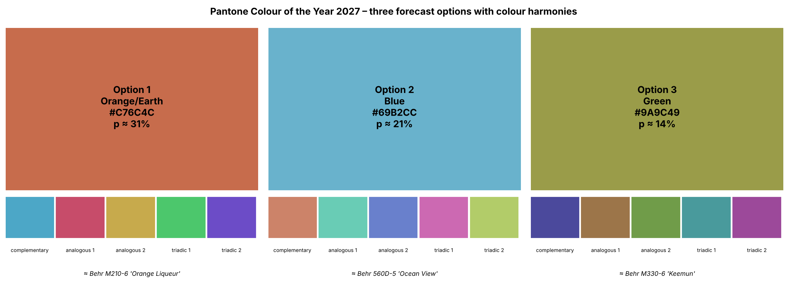

# Fashion Colour Forecast — Can ML predict the Pantone Colour of the Year?

**Authors:** Claude (Anthropic) · David Aguilar · Camila Gómez — *preprint, 12 October 2026*



## 📄 Read the paper

🌐 **Website:** https://doar95.github.io/fashion-color-forecast/

* **English:** [paper/paper_EN.md](paper/paper_EN.md)
* **Español:** [paper/paper_ES.md](paper/paper_ES.md)
* Full notebook with code and figures: [fashion_color_forecast.ipynb](fashion_color_forecast.ipynb)

## What is inside

| File | Content |
|---|---|
| `fashion_color_forecast.ipynb` | The full study: data, colour science, Excel export, chromatic circle, 17 forecasting models with walk-forward back-testing, evidence-fusion classifier, 2027 forecast, critique, and the paper in **English** and **Spanish** |
| `data/color_database.xlsx` | Colour database with real colour swatches painted in the cells (Pantone 2000–2026, paint-brand Colours of the Year, decade palettes 1920s–2020s, harmonies, back-test and forecast sheets) |
| `data/color_database.csv` | Same database in plain text (HEX, RGB, CMYK, HSV, HSL, CIELAB, LCh, families, harmonies) |
| `data/paint_color_universe.csv` | 11,730 commercial paint colours used to name the forecast colours (from the MIT-licensed *colornerd* dataset) |
| `paper/paper_EN.md`, `paper/paper_ES.md` | The paper as standalone Markdown |
| `figures/` | All figures |
| `fashion_color_forecast.html` | The executed notebook as a web page (open with a double click) |
| `GUIA_GITHUB_ES.md` | Step-by-step guide (Spanish) to run the notebook and publish on GitHub |

## Main results

* Pantone's choices are **anti-persistent**: each colour moves away from the previous one (permutation p ≈ 0.02).
* 17 models (naive, mean, trend, VAR, Ridge, k-NN analogues, Random Forest, Gradient Boosting, Gaussian Process, MLP, industry-consensus and pooled models) reduce colour error by at most ~28% versus a random draw and **do not beat the historical mean**.
* A fusion of base rates, novelty and paint-industry leading indicators put the true colour family in its **top 3 in 12 of 16 years** (75%, p ≈ 0.01).

### Pantone Colour of the Year 2027 — pre-registered forecast (12 Oct 2026)

| Option | Family | p (calibrated) | HEX |
|---|---|---|---|
| 1 | Orange/Earth (terracotta) | ≈ 31% | `#C76C4C` |
| 2 | Blue (clear mid blue) | ≈ 21% | `#69B2CC` |
| 3 | Green (olive) | ≈ 14% | `#9A9C49` |

Pantone announces in early December 2026 — this repository is the test.

## Run it

```bash
pip install -r requirements.txt
jupyter notebook fashion_color_forecast.ipynb      # or: jupyter lab
```
Running all cells regenerates the Excel/CSV database and every figure (≈ 2 minutes).

---

## Resumen en español

Estudio reproducible que construye una base de datos de colores de moda (Pantone 2000–2026, Colores del Año de marcas de pintura y paletas por década 1920–2020) en HEX, RGB, CMYK, HSV y CIELAB, la exporta a Excel con las muestras de color pintadas, prueba 17 modelos de series de tiempo y machine learning con back-test walk-forward y pronostica con tres opciones el Color del Año Pantone 2027: **terracota #C76C4C (≈31 %)**, **azul #69B2CC (≈21 %)** o **verde oliva #9A9C49 (≈14 %)**. El artículo completo está en inglés y en español dentro del notebook y en la carpeta `paper/`.

---

*PANTONE® is a registered trademark of Pantone LLC. This independent study is not affiliated with or endorsed by Pantone or any paint manufacturer. HEX values are sRGB approximations.*
