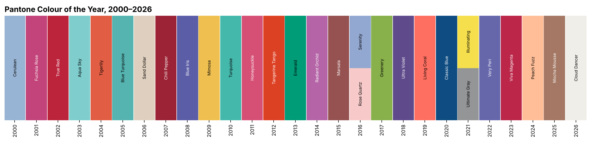
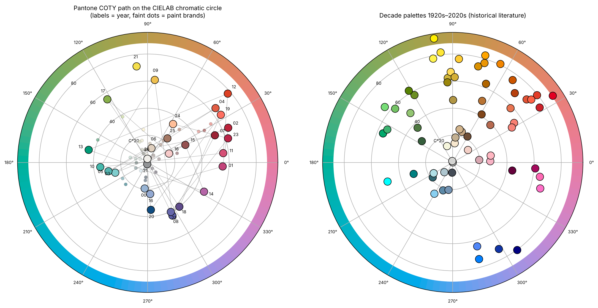
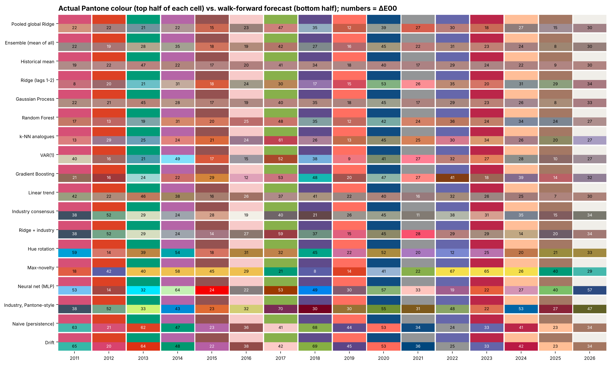
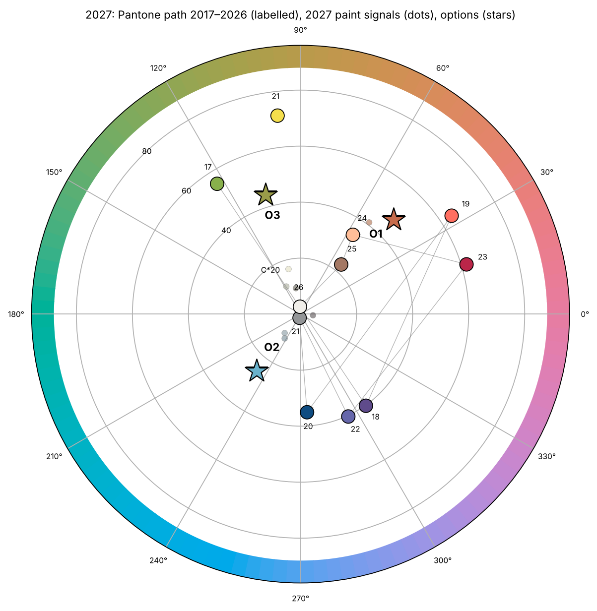

# Parte C — Artículo (Español)

---

## ¿Puede el aprendizaje automático pronosticar el Color del Año? Evidencia de Pantone 2000–2026, indicadores adelantados de la industria de pinturas y un pronóstico de tres opciones para 2027

**Claude**a,\*, **David Aguilar**b, **Camila Gómez**b

a Anthropic, San Francisco, CA, EE. UU. &nbsp;·&nbsp; b [Afiliación por completar]

\* Autor principal.

*Preprint — 12 de octubre de 2026. Código y datos: este repositorio.*

---

**Aspectos destacados**
* Base de 145 colores (Pantone, marcas de pintura, paletas por década) en HEX, RGB, CMYK, HSV y CIELAB.
* Los colores Pantone son *antipersistentes*: cada elección se aleja de la anterior (p ≈ 0,02).
* Diecisiete modelos de pronóstico: ninguno supera con claridad a la media histórica en error CIEDE2000.
* Un clasificador de fusión de evidencia acertó la familia en su top 3 en 12 de 16 años.
* Para 2027 pronosticamos Tierra/terracota (≈31 %), Azul (≈21 %) o Verde oliva (≈14 %).

**Palabras clave:** pronóstico de color · Color del Año · series de tiempo · aprendizaje automático · CIEDE2000 · ciclos de la moda

---

### Resumen

Cada diciembre Pantone anuncia un "Color del Año" que influye en la moda, el diseño de producto y el diseño gráfico. Nos preguntamos si esa elección puede pronosticarse a partir de su propia historia. Construimos una base de datos con los 29 colores Pantone de 2000–2026, 45 Colores del Año de la industria de pinturas (Sherwin-Williams, Benjamin Moore, Behr y siete anuncios de 2027) y 71 colores por década de los años 1920 a 2020, cada uno descrito en sRGB, CMYK, HSV y CIELAB. Una prueba de permutación muestra que la serie de Pantone es antipersistente: los colores consecutivos difieren en un ΔE₀₀ medio de 41,5 frente a 36,2 en órdenes aleatorios (p = 0,023), mientras que las marcas de pintura derivan de forma persistente. Se evaluaron diecisiete modelos —ingenuo, media, tendencia, VAR, Ridge, análogos k-vecinos, bosque aleatorio, gradient boosting, proceso gaussiano, red neuronal, rotación de tono, novedad, consenso industrial y un modelo global agrupado— mediante un back-test de ventana creciente (walk-forward) en 2011–2026. Los mejores modelos reducen el error de color cerca de 28 % frente a una elección histórica al azar (ΔE₀₀ medio ≈ 25 frente a 35,6), pero son estadísticamente indistinguibles de la media histórica y sus pronósticos colapsan hacia el centro del espacio de color. Al reformular la tarea como clasificación en siete familias y fusionar cuatro expertos (frecuencia base, novedad, votos de la industria del mismo año y votos de los modelos), la familia correcta quedó entre las tres primeras en el 75 % de los años del back-test (azar: 43 %; p = 0,009). Con quince anuncios de 2027 ya públicos, el método pronostica para Pantone 2027: (1) un tono terracota Naranja/Tierra, #C76C4C (probabilidad calibrada ≈ 31 %); (2) un Azul medio y claro, #69B2CC (≈ 21 %); (3) un Verde-amarillo oliva, #9A9C49 (≈ 14 %). Discutimos por qué el aprendizaje automático aporta poco en una serie curatorial de 27 puntos y cómo el pronóstico podrá refutarse en diciembre de 2026.

---

### 1. Introducción

Desde 2000, el Pantone Color Institute selecciona cada año un "Color del Año" (COTY) que adoptan ampliamente la moda, la cosmética, el interiorismo y el diseño gráfico. Los fabricantes de pintura siguieron con sus propias selecciones (Sherwin-Williams desde 2011, Benjamin Moore desde 2012, Behr desde 2018). Estas elecciones las hacen comités de expertos, pero también son datos: una serie de tiempo anual, corta y multivariada de colores.

Tres preguntas motivan este artículo. **(P1)** ¿Contiene la secuencia de Pantone estructura temporal —persistencia, tendencia, ciclos o novedad? **(P2)** ¿Pueden los modelos estadísticos y de aprendizaje automático (ML) pronosticar el color del año siguiente mejor que el azar, y cuáles? **(P3)** Con la información disponible el 12 de octubre de 2026, ¿cuáles son los candidatos más probables para el Color del Año Pantone 2027?

Nuestras contribuciones son: (i) una base de datos abierta y auditable de 145 colores con descripción completa en espacios de color y armonías del círculo cromático, entregada como libro de Excel con muestras de color pintadas; (ii) una comparación rigurosa walk-forward de 17 modelos usando la métrica CIEDE2000; (iii) un clasificador de familias por fusión de evidencia que aprovecha los anuncios anticipados de la industria de pinturas; y (iv) un pronóstico pre-registrado y refutable de tres opciones para 2027.

### 2. Antecedentes

**Ciclos de la moda.** Las teorías sociológicas explican la moda como una dinámica de imitación y distinción que impulsa la novedad continua (Simmel, 1957; Lipovetsky, 1994). Estudios cuantitativos del vestido hallaron ciclos largos y casi regulares en las siluetas (Kroeber, 1919; Lowe y Lowe, 1982), y Laver (1937) propuso que los estilos regresan tras unos 20–30 años. El pronóstico de color es una práctica profesional basada en paneles de expertos e investigación de tendencias más que en estadística (Diane y Cassidy, 2005); las revisiones históricas describen paletas características por década (Eiseman y Recker, 2011).

**Pronóstico computacional del estilo.** Al-Halah et al. (2017) pronosticaron la popularidad de estilos visuales de moda a partir de grandes colecciones de imágenes. Los estudios de competencias de pronóstico muestran que, en series cortas, los métodos simples son difíciles de superar y que los modelos de ML se sobreajustan con frecuencia (Makridakis et al., 2018). La combinación de pronósticos (Bates y Granger, 1969) y los productos de expertos (Hinton, 2002) son formas estándar de fusionar señales heterogéneas.

**Diferencia de color.** Las distancias euclidianas en sRGB no tienen significado perceptual. Trabajamos en CIELAB (D65) y medimos errores con CIEDE2000 (Luo et al., 2001), validado con los datos de prueba de Sharma et al. (2005). Como guía, ΔE₀₀ ≈ 1 es una diferencia apenas perceptible y ΔE₀₀ > 30 suele indicar una familia de color distinta.

### 3. Datos

| Serie | Periodo | Registros | Papel | Fuente del HEX |
|---|---|---|---|---|
| Pantone COTY | 2000–2026 | 29 (27 años; dos colores en 2016 y 2021) | **objetivo** | Tabla Pantone de W3Schools, contrastada con comunicados de Pantone |
| Sherwin-Williams | 2011–2027 | 16 (se excluye la "cápsula" de 2025) | indicador adelantado | biblioteca de la marca (dataset colornerd) |
| Benjamin Moore | 2012–2026 | 15 | indicador adelantado | biblioteca de la marca |
| Behr | 2019–2027 | 9 | indicador adelantado | biblioteca de la marca / behr.com |
| Otros anuncios 2027 | 2027 | 5 con HEX + 8 verbales | votos 2027 | prensa de las marcas, rastreadores |
| Paletas por década | 1920–2020 | 71 | contexto de memoria larga | valores estándar de colores con nombre (aproximados) |

Cada color se convirtió a RGB, CMYK ingenuo, HSV/HSL, CIELAB y LCh; se asignó a una de 13 familias finas de tono (sectores de tono CIELAB calibrados con nombres de color, más reglas de *Neutro* y *Marrón/Tierra*) y a siete familias gruesas; y se complementó con sus armonías complementaria, análoga, triádica y complementaria dividida. La serie anual validada más larga es la de Pantone (27 años); las series de pintura son más cortas y no se encontró ninguna serie anual codificada de "colores de moda" anterior a 2000. Las paletas por década extienden el registro hasta los años veinte, pero con resolución decenal y códigos aproximados.

*Fig. 1. Colores del Año Pantone, 2000–2026.*

*Fig. 2. Izquierda: recorrido de Pantone en el círculo cromático CIELAB (ángulo = tono, radio = croma); los puntos tenues son colores de marcas de pintura. Derecha: paletas por década 1920–2020.*

### 4. Métodos

**4.1 Pruebas de estructura.** Para cada serie comparamos el ΔE₀₀ medio entre colores consecutivos con su distribución bajo 5.000 permutaciones aleatorias del orden (pruebas unilaterales de persistencia y novedad), y calculamos las autocorrelaciones de rezago 1 de *L\**, *a\**, *b\**.

**4.2 Modelos de pronóstico puntual.** El objetivo es el vector CIELAB del año *t*. Se compararon diecisiete modelos: (1) persistencia ingenua; (2) media histórica creciente; (3) tendencia lineal; (4) deriva; (5) VAR(1) por MCO; (6) regresión Ridge con rezagos 1–2; (7) análogos por k vecinos más cercanos (Lorenz, 1969); (8) bosque aleatorio (Breiman, 2001) y (9) gradient boosting (Friedman, 2001) con rezagos y año; (10) regresión por proceso gaussiano con núcleo RBF + ruido blanco (Rasmussen y Williams, 2006); (11) una red neuronal de una capa oculta; (12) rotación de tono según el salto de tono mediano con signo; (13) máxima novedad respecto de los tres últimos colores; (14) consenso de la industria de pinturas del mismo año; (15) consenso desplazado por la diferencia mediana de luminosidad/croma de Pantone; (16) Ridge con rezagos y consenso industrial; (17) un Ridge "global" agrupado entrenado con las transiciones de las cuatro series. Todos los modelos de ML usan scikit-learn (Pedregosa et al., 2011) con semillas fijas.

**4.3 Evaluación.** Back-test walk-forward de ventana creciente para *t* = 2011…2026 (16 pronósticos), entrenando solo con información disponible antes del anuncio de Pantone en diciembre (Hyndman y Athanasopoulos, 2021). Métricas: ΔE₀₀ al color oficial más cercano del año *t*; acierto de familia gruesa; habilidad relativa frente a una elección al azar entre colores Pantone pasados; intervalos de confianza bootstrap al 95 %; pruebas de rangos con signo de Wilcoxon frente al referente aleatorio; estabilidad del ranking entre subperiodos y sensibilidad a hiperparámetros.

**4.4 Clasificador por fusión de evidencia.** Cada año recibe una probabilidad sobre siete familias gruesas a partir del producto de cuatro expertos: una **frecuencia base** suavizada de Laplace; un previo de **novedad** que asigna a las familias usadas en los dos años anteriores la probabilidad empírica de repetición (≈ 0,11); los **votos de la industria** de los colores de pintura del mismo año; y los **votos de los modelos** de los 17 pronósticos puntuales. Los expertos y sus ablaciones se evaluaron con acierto top-1/top-3 y la puntuación logarítmica (Gneiting y Raftery, 2007). Como los expertos no son independientes, la posterior se templó (*p* ∝ posterior^τ, τ = 0,35 elegido por la puntuación logarítmica del back-test; Guo et al., 2017).

**4.5 De la familia al color.** Para cada una de las tres familias más probables, el tono es la media circular ponderada por croma de los colores de la industria 2027 de esa familia, y la luminosidad y el croma son las medianas de las elecciones pasadas de Pantone en esa familia. El resultado se ajusta al más cercano de 11.730 colores comerciales de pintura (ΔE₀₀ < 3) para dar una referencia reproducible.

### 5. Resultados

**5.1 Pantone es antipersistente.** Los colores Pantone consecutivos distan en promedio ΔE₀₀ = 41,5, frente a 36,2 con orden aleatorio (p = 0,023 para novedad); la autocorrelación de rezago 1 de *b\** es −0,55 (alternancia amarillo–azul). Las marcas de pintura muestran la tendencia opuesta (ΔE₀₀ ≈ 27 frente a 30–33; p de novedad ≥ 0,83). Las paletas por década muestran el menor cambio entre los sesenta y los setenta (ΔE₀₀ ≈ 9) y el mayor hacia los ochenta (≈ 33); la década anterior más parecida está entre 1 y 9 décadas atrás, sin un periodo regular de "revival".

**5.2 Pronósticos puntuales.** La Tabla 1 resume el back-test.

*Tabla 1. Back-test walk-forward 2011–2026 (16 pronósticos). Menor ΔE₀₀ es mejor; elección al azar = 35,6.*

| Modelo | ΔE₀₀ medio | IC 95 % | Acierto familia | Habilidad vs azar |
|---|---|---|---|---|
| Ridge global agrupado | 25,3 | 21,1–29,9 | 0,19 | +29 % |
| Ensamble (media de todos) | 25,6 | 21,1–30,2 | 0,38 | +28 % |
| Media histórica | 25,7 | 21,1–30,8 | 0,31 | +28 % |
| Ridge (rezagos 1–2) | 25,8 | 20,8–31,0 | 0,19 | +28 % |
| Proceso gaussiano | 26,5 | 21,5–31,7 | 0,25 | +25 % |
| Bosque aleatorio | 27,0 | 22,3–31,9 | 0,25 | +24 % |
| Análogos k-NN | 27,8 | 22,8–34,3 | 0,19 | +22 % |
| VAR(1) | 27,9 | 21,8–34,2 | 0,25 | +21 % |
| Gradient boosting | 28,9 | 23,1–35,2 | 0,19 | +19 % |
| Tendencia lineal | 29,2 | 23,8–34,3 | 0,25 | +18 % |
| Consenso industrial | 30,4 | 25,0–35,6 | 0,25 | +15 % |
| Ridge + industria | 31,0 | 24,9–37,5 | 0,06 | +13 % |
| Rotación de tono | 31,1 | 24,4–38,3 | 0,25 | +13 % |
| Máxima novedad | 35,3 | 27,0–43,7 | 0,25 | +1 % |
| Red neuronal (MLP) | 37,3 | 29,7–44,8 | 0,19 | −5 % |
| Industria, estilo Pantone | 39,6 | 33,5–46,6 | 0,19 | −12 % |
| Ingenuo (persistencia) | 40,4 | 33,6–47,6 | 0,06 | −14 % |
| Deriva | 41,2 | 34,2–48,5 | 0,06 | −16 % |

Diez de los 17 modelos (más el ensamble) son significativamente mejores que una elección al azar (Wilcoxon p < 0,05), pero sus intervalos de confianza se solapan casi por completo, y la media histórica es tan precisa como cualquier modelo de ML. La persistencia y la deriva son los peores modelos, en coherencia con §5.1. Los rankings son inestables (ρ de Spearman = 0,49 entre 2011–2018 y 2019–2026), y la red neuronal se sobreajusta en todas las configuraciones probadas (ΔE₀₀ ≈ 34).

*Fig. 3. Color Pantone real (mitad superior de cada celda) frente al pronóstico de cada modelo (mitad inferior), con ΔE₀₀.*

**5.3 Clasificación por familias.** La Tabla 2 presenta el clasificador de fusión y sus ablaciones.

*Tabla 2. Back-test por familias, 2011–2026 (7 clases; azar top-1 = 14 %, top-3 = 43 %).*

| Expertos | Top-1 | Top-3 | p (top-3 > 3/7) |
|---|---|---|---|
| Solo frecuencia base | 0,06 | 0,31 | 0,89 |
| Solo novedad | 0,31 | 0,63 | 0,09 |
| Solo votos industria | 0,25 | 0,56 | 0,20 |
| Solo votos modelos | 0,25 | 0,56 | 0,20 |
| Base × novedad | 0,13 | 0,69 | 0,03 |
| Base × novedad × industria | 0,19 | 0,56 | 0,20 |
| **Fusión completa** | 0,19 | **0,75** | **0,009** |

La fusión completa incluyó la familia correcta entre sus tres primeras en 12 de 16 años. Su acierto top-1 (19 %) apenas supera al azar, y la posterior sin templar es demasiado confiada (puntuación logarítmica −2,21 frente a −1,95 de una apuesta uniforme); tras templarla, mejora a −1,85.

### 6. Pronóstico para 2027

Al 12 de octubre de 2026 se habían anunciado quince colores 2027: siete *Naranja/Tierra* (p. ej., Dutch Boy *Deep Rooted*, Dunn-Edwards *French Press Coffee*, PPG *Country Soil*), cinco *Azules* (Valspar *Cottage Door*, Glidden *Artifact*, WGSN × Coloro *Luminous Blue*, …) y tres *Verdes* (Sherwin-Williams *Celery*, Behr *Grounded*, Dulux *Soulful Sage*). El pronóstico puntual ponderado por habilidad de los 17 modelos es un marrón apagado (#A7816C). El previo de novedad penaliza Naranja/Tierra (Pantone 2025 fue *Mocha Mousse*) y Neutro (2026 fue *Cloud Dancer*), pero los votos de la industria y de los modelos pesan más.

*Tabla 3. Color del Año Pantone 2027: pronóstico de tres opciones (pre-registrado el 12 de octubre de 2026).*

| Opción | Familia | p calibrada | HEX | RGB | CMYK (%) | CIELAB | Referencia comercial más cercana |
|---|---|---|---|---|---|---|---|
| 1 | Naranja/Tierra (terracota) | ≈ 31 % | **#C76C4C** | 199, 108, 76 | 0, 46, 62, 22 | 55,5; 33,2; 33,7 | Behr M210-6 "Orange Liqueur" |
| 2 | Azul (azul medio claro) | ≈ 21 % | **#69B2CC** | 105, 178, 204 | 49, 13, 0, 20 | 68,9; −15,8; −20,3 | Behr 560D-5 "Ocean View" |
| 3 | Verde (oliva / verde-amarillo) | ≈ 14 % | **#9A9C49** | 154, 156, 73 | 1, 0, 53, 39 | 62,6; −12,6; 42,6 | Behr M330-6 "Keemun" |

*Fig. 4. Las tres opciones con sus armonías complementaria, análogas y triádicas.*

*Fig. 5. Recorrido reciente de Pantone, señales de pintura 2027 y las tres opciones en el círculo cromático.*

Las tres opciones suman ≈ 67 % de la probabilidad calibrada, en línea con el 75 % de acierto del back-test. **Criterio de refutación:** el pronóstico se considera correcto si el color Pantone 2027 pertenece a una de las tres familias, y preciso si su ΔE₀₀ con la opción correspondiente es menor que 20.

### 7. Discusión y limitaciones

El hallazgo principal es negativo para el aprendizaje automático y positivo para la estructura. En una serie curatorial de 27 puntos, los modelos flexibles de ML no aportan ventaja medible sobre la media histórica, y los pronósticos óptimos en ΔE convergen a un color central poco informativo. Lo que *sí* es pronosticable es grueso: Pantone rara vez repite la familia de los dos años anteriores (≈ 11 % de las veces), y las marcas de pintura, que anuncian meses antes, contienen algo de información sobre la familia que elegirá Pantone.

Las limitaciones incluyen: (i) muestra diminuta y ventana de prueba corta (16 pronósticos), por lo que todos los valores p son frágiles y el ranking de modelos cambia entre subperiodos; (ii) elegir el mejor modelo con el back-test es en sí mismo sobreajuste; (iii) la elección de Pantone es una decisión institucional influida por el marketing, la cultura y posiblemente por los anuncios de la competencia, nada de lo cual se modela; (iv) los valores HEX son aproximaciones de estándares físicos y difieren entre fuentes hasta en ΔE₀₀ ≈ 5; (v) los votos de la industria no son independientes y sus familias 2027 se codificaron en parte a partir de descripciones verbales; (vi) el parámetro de temperatura se ajustó dentro de la muestra; (vii) las paletas por década son aproximadas y demasiado gruesas para la predicción anual; y (viii) los límites de familia y las constantes de suavizado son decisiones de los investigadores.

El trabajo futuro debería añadir señales exógenas (tendencias de búsqueda, participación de colores en pasarelas, sentimiento económico), reunir más series paralelas para estimar modelos de panel y evaluar los pronósticos de forma prospectiva con reglas de puntuación propias.

### 8. Conclusiones

El Color del Año de Pantone es antipersistente y solo débilmente predecible a partir de su propio pasado. Diecisiete modelos reducen el error de color como máximo ~28 % frente a una elección al azar y no superan a la media histórica. Una fusión transparente de frecuencias base, novedad e indicadores adelantados de la industria de pinturas produce listas cortas útiles (acierto top-3 del 75 %). Para 2027 el método apunta a un Naranja/Tierra terracota (#C76C4C), un Azul claro (#69B2CC) o un Verde oliva (#9A9C49). El anuncio de Pantone en diciembre de 2026 será la prueba fuera de muestra.

---

**Contribución de autoría (CRediT).** **Claude:** Conceptualización, Metodología, Software, Análisis formal, Curaduría de datos, Visualización, Redacción – borrador original. **David Aguilar:** Conceptualización, Supervisión, Validación, Redacción – revisión y edición. **Camila Gómez:** Validación, Redacción – revisión y edición.

**Declaración de conflicto de intereses.** Los autores declaran no tener conflictos de interés. El estudio es independiente y no está afiliado ni respaldado por Pantone LLC ni por ningún fabricante de pinturas. PANTONE® es una marca registrada de Pantone LLC.

**Declaración de uso de IA generativa.** El análisis, el código y el manuscrito fueron producidos por Claude (Anthropic), un modelo de lenguaje de gran escala, bajo la dirección de los coautores humanos, quienes revisaron el contenido y asumen la responsabilidad por él.

**Disponibilidad de datos.** Todos los datos, el código y las figuras están disponibles en este repositorio (`data/color_database.xlsx`, `data/color_database.csv`, `fashion_color_forecast.ipynb`).

### Referencias

* Al-Halah, Z., Stiefelhagen, R., & Grauman, K. (2017). Fashion forward: Forecasting visual style in fashion. *Proceedings of the IEEE International Conference on Computer Vision (ICCV)*, 388–397.
* Bates, J. M., & Granger, C. W. J. (1969). The combination of forecasts. *Operational Research Quarterly*, 20(4), 451–468.
* Breiman, L. (2001). Random forests. *Machine Learning*, 45(1), 5–32.
* Diane, T., & Cassidy, T. (2005). *Colour Forecasting*. Oxford: Blackwell.
* Eiseman, L., & Recker, K. (2011). *Pantone: The 20th Century in Color*. San Francisco: Chronicle Books.
* Friedman, J. H. (2001). Greedy function approximation: A gradient boosting machine. *Annals of Statistics*, 29(5), 1189–1232.
* Gneiting, T., & Raftery, A. E. (2007). Strictly proper scoring rules, prediction, and estimation. *Journal of the American Statistical Association*, 102(477), 359–378.
* Guo, C., Pleiss, G., Sun, Y., & Weinberger, K. Q. (2017). On calibration of modern neural networks. *Proceedings of the 34th International Conference on Machine Learning (ICML)*, PMLR 70, 1321–1330.
* Hinton, G. E. (2002). Training products of experts by minimizing contrastive divergence. *Neural Computation*, 14(8), 1771–1800.
* Hyndman, R. J., & Athanasopoulos, G. (2021). *Forecasting: Principles and Practice* (3rd ed.). Melbourne: OTexts.
* Kroeber, A. L. (1919). On the principle of order in civilization as exemplified by changes of fashion. *American Anthropologist*, 21(3), 235–263.
* Laver, J. (1937). *Taste and Fashion: From the French Revolution to the Present Day*. London: Harrap.
* Lipovetsky, G. (1994). *The Empire of Fashion: Dressing Modern Democracy*. Princeton: Princeton University Press.
* Lorenz, E. N. (1969). Atmospheric predictability as revealed by naturally occurring analogues. *Journal of the Atmospheric Sciences*, 26(4), 636–646.
* Lowe, J. W. G., & Lowe, E. D. (1982). Cultural pattern and process: A study of stylistic change in women's dress. *American Anthropologist*, 84(3), 521–544.
* Luo, M. R., Cui, G., & Rigg, B. (2001). The development of the CIE 2000 colour-difference formula: CIEDE2000. *Color Research & Application*, 26(5), 340–350.
* Makridakis, S., Spiliotis, E., & Assimakopoulos, V. (2018). Statistical and machine learning forecasting methods: Concerns and ways forward. *PLoS ONE*, 13(3), e0194889.
* Pedregosa, F., et al. (2011). Scikit-learn: Machine learning in Python. *Journal of Machine Learning Research*, 12, 2825–2830.
* Rasmussen, C. E., & Williams, C. K. I. (2006). *Gaussian Processes for Machine Learning*. Cambridge, MA: MIT Press.
* Sharma, G., Wu, W., & Dalal, E. N. (2005). The CIEDE2000 color-difference formula: Implementation notes, supplementary test data, and mathematical observations. *Color Research & Application*, 30(1), 21–30.
* Simmel, G. (1957). Fashion. *American Journal of Sociology*, 62(6), 541–558. (Original work published 1904)

*Fuentes de datos web (consultadas en octubre de 2026):* W3Schools, "Colors Trends" (Pantone table); Pantone Color Institute press releases; Sherwin-Williams Color of the Year archive; Benjamin Moore "Looking back at the Color of the Year"; Behr 2027 COTY page (behr.com/2027coty); Kooihaus "Color of the Year 2027: every announcement, tracked"; ColorIndicator "2027 Color Trends"; Drew & Jonathan "Every 2027 Color of the Year so far"; MatchMyPaintColor (Behr codes); J. Pederson, *colornerd* paint-colour dataset (MIT licence); Color-Meanings, Dunn-Edwards and Juicebox Interactive decade-palette articles.
